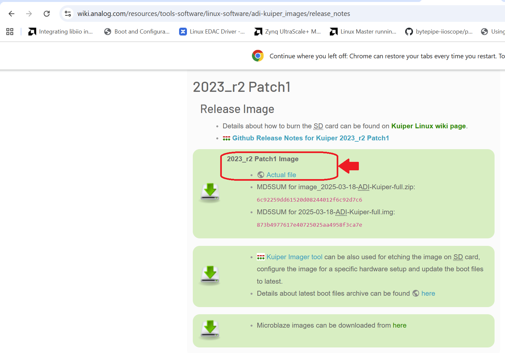

# KuiperLinux
Tutorial for running Kuiper Linux on the Bytepipe

### What is this?
This README a guide that illustrates how set up a Kuiper Linux SD card that works with the Bytepipe.
  - **Quick Start:** follow the tutorial and use prebuilt files as directed.
  - **Build from Source:** Skip the "prebuilt" options offered in the tutorial.

### Why Kuiper Linux?
Kuiper Linux is pre-loaded with thousands of drivers for ADI products. This provides greater ease when developing with the ADRV9002 installed on the Bytepipe. 

In addition, GNU-radio is pre-installed to further facilitate embedded development.

[More Infomation about Kuiper Linux](https://www.analog.com/en/resources/evaluation-hardware-and-software/embedded-development-software/kuiper-linux.html#software-overview)

# 

### Overview

1. [Project directory selection](#project-directory-selection)
    - Choose a project directory
    - Clone this repo into that directory
2. [Kuiper Linux Setup](#kuiper-linux-setup)
    - Flash generic Kuiper Image to sd card
    - Build BOOT.BIN
    - Build device tree
    - Finalize Kuiper enabled sd card for booting on Bytepipe

### Attention: Run Linux or Windows with a VM for everything other than building HDL
Building system.dtb, u-boot.elf, and BOOT.BIN is much simpler when running a linux OS on your build machine, so most of the steps in this guide will only be accompanied by linux bash command line code. 

If you are running a windows machine, command line code is available for cloning this repo and building hdl in Vivado. After performing those two tasks, I reccomend you use a virtual machine to run Ubuntu v20.04 or v22.04. 

## Project directory selection
1) Clone
Windows Command Prompt, Windows Git Bash, or Linux Terminal
(Download Git Bash for Windows - https://git-scm.com/install/windows)
```
git clone https://github.com/NextGenRF-Design-Inc/KuiperLinuxBytepipe.git
cd KuiperLinuxBytepipe
```
2) Setup workspace
Windows Command Prompt, Windows Git Bash, or Linux Terminal
```
cd <path to desired parent directory that will hold your project>

mkdir workspace
cd workspace
```
## Kuiper Linux Setup
Kuiper Linux is a distribution based on Raspberry Pi OS for the Raspberry Pi. It incorporates thousands of Linux device drivers for ADI products.
Kuiper Linux is provided by Analog Devices.

### 1. Flash generic Kuiper Image to sd card
1) Download Kuiper Image from https://wiki.analog.com/resources/tools-software/linux-software/adi-kuiper_images/release_notes

2) Flash Kuiper Image to SD card. Use Kuiper Imager tool if possible.
3) Copy Zynqmp Common Image file to root (or top-level) of sd card's BOOT partition.
```
export BOOT_PATH=<path to BOOT partition of your SD card post flash>
cd $BOOT_PATH
cp -f $BOOT_PATH/zynqmp-common/Image $BOOT_PATH/Image
```

At this point, your Kuiper sd card only missing **BOOT.BIN** and **system.dtb**. 
Both of which can be aquired from this repo's [prebuilt](prebuilt/) directory or built from scratch.
BOOT.BIN is Bytepipe model specific, but system.dtb is not.

If you decided to use prebuilt files, go to the [Use Prebuilt BOOT.BIN](#2a-use-prebuilt-bootbin) section of this document. 
Otherwise, continue to [Compile BOOT.BIN](#2b-compile-bootbin)

### 2a. Use Prebuilt BOOT.BIN
1) Copy prebuilt BOOT.BIN to sd card
```
export MY_APP_DIR=<project folder path>
cd $MY_APP_DIR
```
```
cp -f  prebuilt/BOOT_3CG.BIN $BOOT_PATH/BOOT.BIN
```
-or-
```
cp -f  prebuilt/BOOT_3EG.BIN $BOOT_PATH/BOOT.BIN
```

### 2b. Compile BOOT.BIN

1) Move to workspace directory
```
export MY_APP_DIR=<project folder path>
cd $MY_APP_DIR/workspace
```
2) FSBL files zynqmp_fsbl_3cg.elf and zynqmp_fsbl_3eg.elf are included in this repo's sw directory.

   
Copy the one that matches your bytepipe model and rename the copy to "fsbl.elf".
```
cp -f zynqmp_fsbl_3cg.elf ./fsbl.elf
```
-or-
```
cp -f zynqmp_fsbl_3eg.elf ./fsbl.elf
```
3) Run [build_zynqmp_boot_bin_external_fsbl.sh](sw/build_zynqmp_boot_bin_external_fsbl.sh). build_zynqmp_boot_bin_external_fsbl.sh is a modified boot.bin build script that uses the fsbl.elf in the same directory as the boot.bin build script. The original is found [here](https://raw.githubusercontent.com/analogdevicesinc/wiki-scripts/main/zynqmp_boot_bin/build_zynqmp_boot_bin.sh).
   
**system_top.xsa compile instructions are [here](#compile-system_topxsa) and prebuilt instructions are [here](#use-prebuilt-systemdtb)** 

**u-boot.elf compile instructions are [here](#compile-u-bootelf) and prebuilt instructions are [here](#use-prebuilt-u-bootelf)**

```
./../sw/build_zynqmp_boot_bin_external_fsbl.sh system_top.xsa u-boot.elf download
```
**Note: The download option pulls the bl31.elf (ARM Trusted Firmware runtime binary compiled for Exception Level 3) from the web.**

4) Copy BOOT.BIN to sd card BOOT directory
```
cp -f output_boot_bin/BOOT.BIN $BOOT_PATH/Image
```
### Use Prebuilt system.dtb

1) Copy prebuilt system.dtb to sd card
```
export MY_APP_DIR=<project folder path>
cd $MY_APP_DIR
cp -f prebuilt/system.dtb $BOOT_PATH/system.dtb
```

### Compile system.dtb

1) Install prerequisites:
```
sudo apt update
sudo apt install -y \
    git make gcc-aarch64-linux-gnu binutils-aarch64-linux-gnu \
    bc bison flex libssl-dev libelf-dev device-tree-compiler \
    u-boot-tools
```
2) Clone ADI linux kernel repo
```
cd $MY_APP_DIR
git clone --depth 1 \
    --branch 2023_r2_p1 \
    https://github.com/analogdevicesinc/linux.git \
    linux-adi-2023-r2-p1

cd linux-adi-2023-r2-p1
```
3) Configure ZynqMP kernel tree
```
XILINX_AMD_TOOLS=<path to directory containing xilinx installation>

export ARCH=arm64
export CROSS_COMPILE="${XILINX_AMD_TOOLS}/Xilinx/Vitis/2023.2/gnu/aarch64/lin/aarch64-linux/bin/aarch64-linux-gnu-"

make adi_zynqmp_defconfig
```
4) Copy your device tree source (.dts) file into the cloned repo
```
export LIN_DTS_DIR=arch/arm64/boot/dts/xilinx

cp ../sw/zynqmp-bytepipe_v2023_2.dts \
   "$LIN_DTS_DIR/bytepipe.dts"
```
5) Register your device tree in the device tree makefile.
```
chmod +x ../sw/add-zynqmp-dtb.sh
./../sw/add-zynqmp-dtb.sh bytepipe.dtb
```
5) Compile .dtb
```
make xilinx/bytepipe.dtb
```
6) Copy bytepipe.dtb to workspace directory as system.dtb
```
cp -f arch/arm64/boot/dts/xilinx/bytepipe.dtb ../workspace/system.dtb
```
### Use Prebuilt system_top.xsa

1) Copy prebuilt system_top.xsa to workspace
```
export MY_APP_DIR=<project folder path>
cd $MY_APP_DIR
```
```
cp -f prebuilt/3CG/system_top.xsa workspace/system_top.xsa
```
-or-
```
cp -f prebuilt/3EG/system_top.xsa workspace/system_top.xsa
```
**Note: system_top.xsa is actually a zip folder, so renaming only the xsa folder does not rename it's contents. Mismatch between xsa file name and contents will cause errors in BOOT.BIN creation. Exporting the vivado project hardware as system_top.xsa is better so there is no confusion.**

### Compile system_top.xsa 

1) Source Vivado and Vitis
   
Windows Command Prompt:
```
set XILINX_AMD_TOOLS=<path to directory containing xilinx installation>
call %XILINX_AMD_TOOLS%\Xilinx\Vivado\2023.2\settings64.bat
vivado -version
echo %XILINX_VIVADO%
where vivado
call %XILINX_AMD_TOOLS%\Xilinx\Vitis\2023.2\settings64.bat
vitis -version
echo %XILINX_VITIS%
where vitis
```

Linux Terminal:
```
export XILINX_AMD_TOOLS=<path to directory containing xilinx installation>
source $XILINX_AMD_TOOLS/Xilinx/Vivado/2023.2/settings64.sh
vivado -version
which vivado
source $XILINX_AMD_TOOLS/Xilinx/Vitis/2023.2/settings64.sh
vitis -version
which vitis
```
2) Run HDL build makefile

Windows Command Prompt:
```
cd <project workspace directory>
make -f ..\hdl\Makefile.windows DEVICE=<xczu3cg,xczu3eg> MODE=lvds
```

Linux Terminal:
```
cd <project workspace directory>
make -f ../hdl/Makefile
```

### Use Prebuilt u-boot.elf

1) Copy prebuilt u-boot.elf to workspace
```
export MY_APP_DIR=<project folder path>
cd $MY_APP_DIR
cp -f prebuilt/u-boot.elf workspace/u-boot.elf
```

### Compile u-boot.elf

1) Install build dependencies
```
sudo apt update
sudo apt install -y \
    git \
    build-essential \
    gcc-aarch64-linux-gnu \
    bc \
    bison \
    flex \
    device-tree-compiler \
    libssl-dev \
    libgnutls28-dev \
    libncurses-dev \
    python3 \
    python3-dev \
    python3-setuptools \
    python3-pyelftools \
    swig
```
2) Clone the Xilinx 2023.2 branch
```
cd $MY_APP_DIR
git clone \
    --branch xilinx-v2023.2 \
    --depth 1 \
    https://github.com/Xilinx/u-boot-xlnx.git
```
3) Enter u-boot directory
```
cd u-boot-xlnx
```
4) Set the cross-compilation environment
```
export ARCH=arm
export CROSS_COMPILE=$XILINX_AMD_TOOLS/Xilinx/Vitis/2023.2/gnu/aarch64/lin/aarch64-linux/bin/aarch64-linux-gnu-
```
5) Clean the source tree
```
make distclean
```
6) Select the ZynqMP configuration
```
make xilinx_zynqmp_virt_defconfig
```
7) Copy your device tree source (.dts) file into the cloned repo
```
export DTS_DIR=arch/arm/dts/

cp ../sw/zynqmp-bytepipe_v2023_2_uboot.dts \
   "$DTS_DIR/bytepipe_uboot.dts"
```

8) Register device tree
```
chmod +x ../sw/register-uboot-dts.sh
./../sw/register-uboot-dts.sh bytepipe_uboot.dtb
```
9) Build u-boot
```
make -j"$(nproc)" \
    DEVICE_TREE=bytepipe_uboot
```
10) Copy u-boot.elf to workspace directory
```
cp -f u-boot.elf ../workspace/u-boot.elf
```


